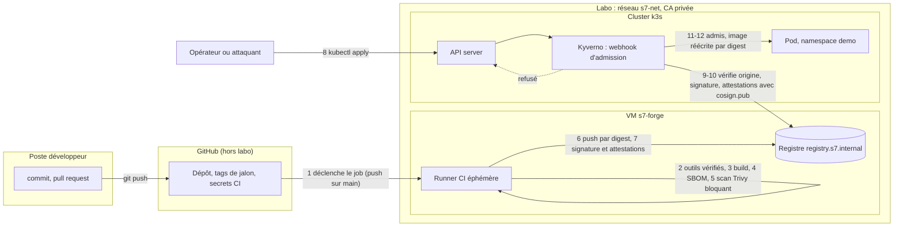

# Architecture de la chaîne CI/CD sécurisée (Sujet 7)

Version : v0.3 du 2026-11-05. Sections 3 (lignes cluster), 4, 5 (étapes 8 à 12) et 9 (hypothèses cluster) :
étudiant A. Sections 2, 3 (lignes CI), 5 (étapes 1 à 7) et 9 (hypothèses CI et registre) : étudiant B.

## 1. Objectifs et périmètre

Une image déployée doit pouvoir justifier d'où elle vient, de quoi elle est faite et qui l'a construite.
La CI ne signe que ce qui a passé le scan ; le cluster refuse tout ce qui n'est pas signé par notre clé.
Les deux contrôles sont indépendants : la compromission de l'un ne suffit pas à faire exécuter une image non vérifiée.

Hors périmètre : la détection en cours d'exécution (une CVE publiée après le déploiement n'est pas détectée), la haute
disponibilité du plan de contrôle, la gestion de plusieurs clusters.

## 2. Vue d'ensemble



## 3. Composants et choix

| Composant | Rôle | Où | Choix | ADR |
| --- | --- | --- | --- | --- |
| Dépôt Git | source de vérité, tags de jalon | GitHub | existant | ADR-002 |
| Runner CI | build, SBOM, scan, signature, attestation | VM `s7-forge` | runner GitHub Actions auto-hébergé `v2.338.2`, utilisateur dédié sans `sudo`, jobs de `push` sur `main` et tags seulement ; les PR tournent sur des runners hébergés par GitHub, sans secret | ADR-002 |
| Registre | images, signatures, attestations | VM `s7-forge` | Zot `v2.1.22` (binaire *minimal*, systemd), TLS 443 avec la CA privée, lecture anonyme, push réservé au compte `ci`, API OCI 1.1 *referrers* ; images au format OCI uniquement | ADR-002 |
| Outils supply chain | Syft, Trivy, Cosign, crane | runner | Syft `v1.55.0`, Trivy `v0.76.1`, Cosign `v3.1.4` (clé statique, sans Rekor), crane `v0.22.1` ; binaires vérifiés par SHA-256 (`versions.yaml`) | ADR-003 |
| Virtualisation | VM du socle | hôte du labo | KVM/libvirt, image cloud Ubuntu 24.04, cloud-init | ADR-001 |
| Cluster | exécution de l'application | `s7-cp` + `s7-w1` (+ `s7-w2`) | k3s `v1.35.9+k3s1`, Traefik et ServiceLB désactivés | ADR-001 |
| Admission | vérifie origine, signature, puis attestations | namespace `kyverno` | Kyverno v1.19.2 (chart 3.9.2), `ImageValidatingPolicy` | ADR-004 |
| CA privée | certificat du registre | générée par B | approuvée par le runner, containerd sur chaque nœud et Kyverno | ADR-002 |
| Application témoin | API web + Dockerfile (saine et vulnérable) | namespace `demo` | API Python minimale (FastAPI, `/health`), image `registry.s7.internal/s7/demo-app`, base épinglée par digest, utilisateur non-root ; variante vulnérable : une dépendance ancienne avec une CVE HIGH/CRITICAL corrigée (choisie dans S5) | ADR-003 |

## 4. Infrastructure

### 4.1 Machines physiques

Relevé complet dans [docs/inventaire.md](inventaire.md).

| Machine | CPU | RAM | Disque | KVM |
| --- | --- | --- | --- | --- |
| `laptopdlamort` (portable de l'étudiant B, Ubuntu 24.04.5, noyau 7.0) | i5-12450H, 12 cœurs logiques | 15 Gi (4,7 Gi disponibles au relevé) | `/` : 140 Go (26 Go libres) ; NVMe 3,6 To et 954 Go | oui (`/dev/kvm`, 24 drapeaux vmx) |

### 4.2 Machines virtuelles

| VM | Rôle | vCPU | RAM | Disque | IP |
| --- | --- | --- | --- | --- | --- |
| `s7-forge` | runner CI + registre | 2 | 4 Go | 60 Go | 192.168.100.10 |
| `s7-cp` | serveur k3s (plan de contrôle, SQLite intégré) | 2 | 4 Go | 30 Go | 192.168.100.20 |
| `s7-w1` | agent k3s (charge applicative) | 2 | 4 Go | 30 Go | 192.168.100.21 |
| `s7-w2` (si la RAM le permet) | agent k3s | 2 | 4 Go | 30 Go | 192.168.100.22 |

Total : 6 vCPU, 12 Go de RAM et 120 Go de disque pour 3 VM ; 8 vCPU, 16 Go et 150 Go avec `s7-w2`. Il faut garder
au moins 2 Go pour l'hôte. Si la machine a moins de 16 Go, on passe à 3 Go par VM sur `s7-cp` et `s7-w1` et on
renonce à `s7-w2` ; `s7-forge` garde 4 Go, car le build et le scan d'une image Python le demandent.

Toutes les VM sont créées depuis la même image cloud Ubuntu 24.04 (répertoire daté, contrôlée par `SHA256SUMS`),
en disques qcow2 adossés à cette image. Cloud-init fixe le nom d'hôte, l'IP statique, l'utilisateur `s7` (clé SSH
seulement, pas de mot de passe), les entrées DNS du projet, chrony et le certificat de la CA privée.

### 4.3 Réseau et adressage

| Plage | Usage | Remarque |
| --- | --- | --- |
| 192.168.100.0/24 | réseau libvirt `s7-net` (NAT), passerelle .1 | à changer s'il chevauche le réseau du labo |
| 10.42.0.0/16 | pods (flannel VXLAN, valeur par défaut de k3s) | MTU des pods = MTU de l'interface − 50 |
| 10.43.0.0/16 | services Kubernetes (valeur par défaut de k3s) | CoreDNS en 10.43.0.10 |

| Nom | IP | Port(s) exposé(s) |
| --- | --- | --- |
| `registry.s7.internal` | 192.168.100.10 | 443 (registre en TLS) |
| `k3s-cp.s7.internal` | 192.168.100.20 | 6443 (API Kubernetes), 10250 (kubelet) |
| `k3s-w1.s7.internal` | 192.168.100.21 | 10250 (kubelet), NodePort 30000-32767 |

Les noms sont déclarés dans le DNS du réseau libvirt (élément `<dns><host>`) et, en secours, dans `/etc/hosts` par
cloud-init. Le suffixe `.internal` évite `.local`, réservé à mDNS.

### 4.4 Confiance TLS envers le registre

Le registre présente un certificat émis par la CA privée du projet (SAN `registry.s7.internal`). Seul le certificat
public de la CA (`security/ca/ca.crt`) est versionné. Il doit être approuvé à trois endroits côté cluster, sinon on
obtient `x509: certificate signed by unknown authority` :

1. **containerd sur chaque nœud**, pour tirer les images, par `/etc/rancher/k3s/registries.yaml` :

   ```yaml
   mirrors:
     registry.s7.internal:
       endpoint:
         - "https://registry.s7.internal"
   configs:
     "registry.s7.internal":
       tls:
         ca_file: /etc/rancher/k3s/ca-s7.crt
   ```

2. **le magasin de certificats du système** des nœuds (`/usr/local/share/ca-certificates/` puis
   `update-ca-certificates`), pour les outils lancés sur les nœuds ;
3. **le contrôleur d'admission Kyverno**, qui interroge le registre pour lire signatures et attestations, par la
   valeur Helm `admissionController.caCertificates.data`.

### 4.5 Durcissement du cluster (prévu en J2)

- Binaire k3s et script d'installation vérifiés par SHA-256, version figée (ADR-001).
- Traefik et ServiceLB désactivés ; aucun service exposé hors NodePort de l'application témoin.
- Secrets chiffrés au repos (`--secrets-encryption`) ; kubeconfig en `0600`, jamais versionné.
- Pod Security Admission sur `demo` : `enforce=baseline`, `warn=restricted`, puis `enforce=restricted` si
  l'application témoin tourne sans root.
- Kyverno en échec fermé sur `demo` (ADR-004) ; `kube-system` et `kyverno` exclus.
- Chrony sur toutes les VM ; accès SSH par clé uniquement.

## 5. Flux détaillé

1. **Déclenchement.** Un `git push` sur `main` (ou un tag de jalon) déclenche le workflow sur le runner
   auto-hébergé de `s7-forge`. Une pull request ne déclenche qu'un workflow sur un runner hébergé par GitHub :
   construction et scan, sans secret, sans push ni signature. `actions/checkout` est épinglé par SHA, avec
   `persist-credentials: false`. *Preuve* : journal du job, SHA du commit.
2. **Outils.** Le job installe (ou reprend du cache de la forge) Syft, Trivy, Cosign et crane aux versions de
   `versions.yaml` et contrôle leur SHA-256. *Échec* : somme différente, job arrêté (R9).
3. **Construction.** `docker buildx build` produit une archive OCI locale (`--output type=oci`) depuis une image de
   base épinglée par digest. Rien n'est encore dans le registre. *Échec* : job rouge.
4. **SBOM.** Syft génère un SBOM CycloneDX JSON de cette archive. *Preuve* : fichier conservé comme artefact du job.
5. **Scan bloquant.** Trivy analyse l'archive (`--severity HIGH,CRITICAL --ignore-unfixed --exit-code 1`), avec la
   base en cache sur la forge, et produit aussi le résultat au format `cosign-vuln`. *Échec* : job arrêté **avant**
   tout push ni signature : une image vulnérable n'atteint jamais le registre par la CI (attaque 4).
6. **Push par digest.** crane pousse l'archive scannée dans `registry.s7.internal/s7/demo-app` (TLS avec la CA
   privée, compte `ci`). Le job lit le digest renvoyé : c'est lui, et non le tag, qui est signé.
7. **Signature et attestations.** Cosign signe le digest avec la clé de l'environment `signing`, sans Rekor
   (`--signing-config security/cosign/signing-config.json`), puis attache le SBOM (`--type cyclonedx`) et le
   résultat du scan (`--type vuln`) ; en J4, la provenance SLSA. Les trois sont stockés comme *referrers* OCI 1.1
   de l'image. *Preuve* : `cosign tree` et `cosign verify --key security/cosign/cosign.pub --insecure-ignore-tlog=true`.


8. **Demande de déploiement.** Un opérateur (ou un attaquant disposant d'un accès à l'API) envoie un manifeste
   (`kubectl apply`) créant un pod dans `demo`. L'API server authentifie, autorise (RBAC) puis appelle les webhooks
   d'admission.
9. **Vérification de l'origine.** Kyverno refuse toute image qui ne vient pas de `registry.s7.internal/s7/`.
   *Preuve* : message de refus de la politique.
10. **Vérification de la signature.** Kyverno résout le tag en digest, lit la signature dans le registre (TLS avec la
    CA privée) et la vérifie avec `cosign.pub`. En J4, il vérifie aussi l'attestation SLSA. *Échec* : pod refusé avec
    le message de la politique ; *registre ou Kyverno injoignable* : refus (échec fermé).
11. **Réécriture par digest.** Le pod admis référence l'image par son digest vérifié (`mutateDigest`) : le tag ne peut
    plus être remplacé entre la vérification et l'exécution.
12. **Exécution.** Le kubelet du nœud demande l'image à containerd, qui la tire du registre en TLS (via
    `registries.yaml`) ; le pod démarre sous les restrictions de Pod Security Admission. *Preuve* :
    `kubectl get pod -n demo -o jsonpath='{.spec.containers[*].image}'` montre une référence `@sha256:`.

## 6. Modèle de menace

| Menace | Contrôle | Démo (J3-J4) |
| --- | --- | --- |
| Image poussée directement dans le registre, sans passer par la CI | signature exigée par l'admission | Attaque 1 |
| Image tirée d'un autre registre | règle d'origine de la politique d'admission | Attaque 1 (variante) |
| Image signée avec la clé de l'attaquant | vérification contre `cosign.pub` | Attaque 2 |
| Tag écrasé ou image modifiée après signature | signature et résolution par digest | Attaque 3 |
| Dépendance vulnérable introduite par une PR | Trivy bloquant avant signature | Attaque 4 |
| Image construite hors CI, provenance falsifiée | attestation SLSA exigée | Attaque 5 |
| Fuite de la clé privée de signature | non couvert : secrets CI, rotation | limite |
| Runner ou outil de CI compromis | non couvert : runner éphémère, versions épinglées | limite |
| Administrateur du cluster qui supprime le webhook | non couvert : RBAC, journal d'audit | limite |
| CVE publiée après le déploiement | non couvert : le scan a lieu au build | limite |

## 7. Garanties et limites

| Mécanisme | Garantit | Ne garantit pas |
| --- | --- | --- |
| SBOM | l'inventaire des composants au moment du build | qu'il soit complet, ni authentique s'il n'est pas signé |
| Scan Trivy | l'absence de CVE connues de la base à l'instant du scan | les failles inconnues, le code malveillant, les CVE de demain |
| Signature Cosign | qu'un détenteur de la clé a signé ce digest | que l'image soit saine ; clé ou CI compromise = signature de l'attaquant |
| Provenance SLSA | une déclaration sur dépôt, commit et builder | plus que ce que vaut l'isolation du builder |
| Admission Kyverno | le refus à la création des pods non conformes dans `demo` | les pods déjà admis, les namespaces exclus, un administrateur qui supprime le webhook |
| Réécriture par digest | que le pod exécute exactement l'image vérifiée | que cette image soit sans faille |
| TLS du registre | intégrité et identité du transport | le contenu des images |

## 8. Contrats d'interface entre A et B

| Point | Valeur |
| --- | --- |
| Nom du registre | `registry.s7.internal` (192.168.100.10, port 443) |
| Référence d'image | `registry.s7.internal/s7/demo-app@sha256:<digest>` (toujours par digest) |
| Clé publique de signature | `security/cosign/cosign.pub` |
| Certificat de la CA privée | `security/ca/ca.crt` (certificat public uniquement) |
| Namespace cible | `demo` |

## 9. Hypothèses et contraintes

- La machine dispose de la virtualisation matérielle et d'au moins 16 Go de RAM : virtualisation **confirmée**, RAM
  **non** (15 Gi sur `laptopdlamort`, inventaire du 05/11). On applique donc le profil réduit de la section 4.2 :
  `s7-forge` 4 Go, `s7-cp` et `s7-w1` 3 Go, pas de `s7-w2`. L'ADR-001 (option 1) reste valable.
- Kyverno 1.19 prend en charge Kubernetes 1.33 à 1.35 : k3s reste en 1.35 pendant tout le projet.
- Les signatures produites par Cosign 3 sont vérifiables par Kyverno 1.19 : à confirmer par les spikes S3 et S4.
- Le réseau du labo laisse passer GitHub (binaire k3s, chart Kyverno via `kyverno.github.io`) : à confirmer par
  l'inventaire ; sinon, les artefacts sont copiés et vérifiés depuis un poste qui y a accès.
- GitHub reste joignable depuis le réseau utilisé (inventaire : `github.com` 200) : le runner auto-hébergé reçoit
  ses jobs par une connexion sortante, sans port entrant ouvert sur `s7-forge`.
- Les images de base sont tirées de Docker Hub (ou de `mirror.gcr.io`) sans dépasser la limite de débit ; sinon,
  elles sont copiées une fois dans `registry.s7.internal/s7/base/` (R2).
- La base de Trivy (`mirror.gcr.io`, repli `ghcr.io`) est téléchargée au plus une fois par jour et mise en cache sur
  `s7-forge` (S5).
- Zot reste compatible avec les artefacts de Cosign 3 et de Syft (vérifié dans S2 et S3 avec Zot v2.1.22) ; toutes
  les images poussées sont au format OCI, Zot refusant le format Docker.
- La clé privée Cosign n'existe qu'en trois endroits : l'environment GitHub `signing` et une copie chiffrée hors
  ligne chez chaque étudiant. Seule `security/cosign/cosign.pub` est versionnée.
- Le runner est mis à jour moins de 30 jours après chaque nouvelle version (exigence de GitHub), par PR sur
  `versions.yaml`.
